# SailPoint SDK Usage Statistics

<!-- METRICS_START -->
# Usage Statistics
    
Last updated: 11/2/2026, 12:03:56 AM

Below are stats from artifacts tracked across NPM, GitHub, PyPI and PowerShell.
    
### NPM (JavaScript/TypeScript): 

| Package | Downloads | Monthly Downloads | Weekly Downloads | Daily Downloads |
| --- | --- | --- | --- | --- |
| sailpoint-api-client | 260,657 | 26,965 | 13,176 | 225 |
| **Total** | **260,657** | **26,965** | **13,176** | **225** | | | | |

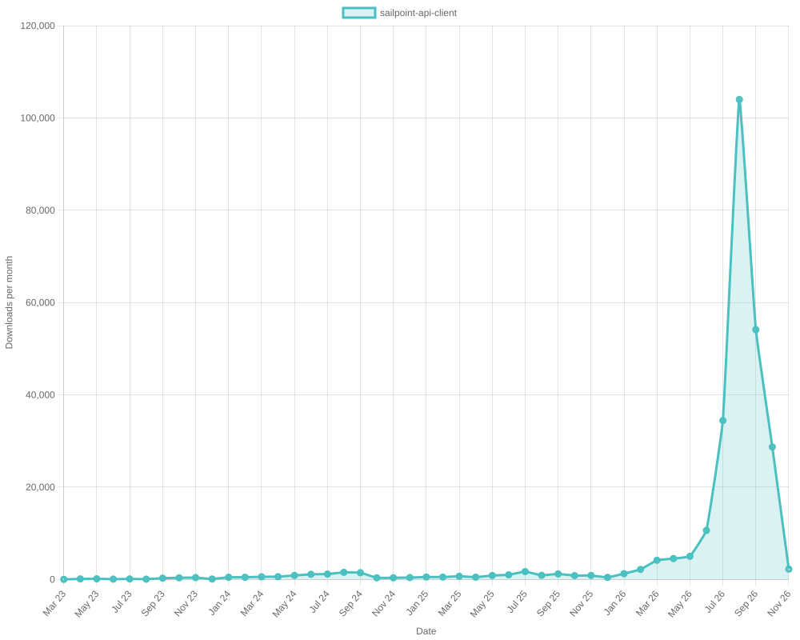
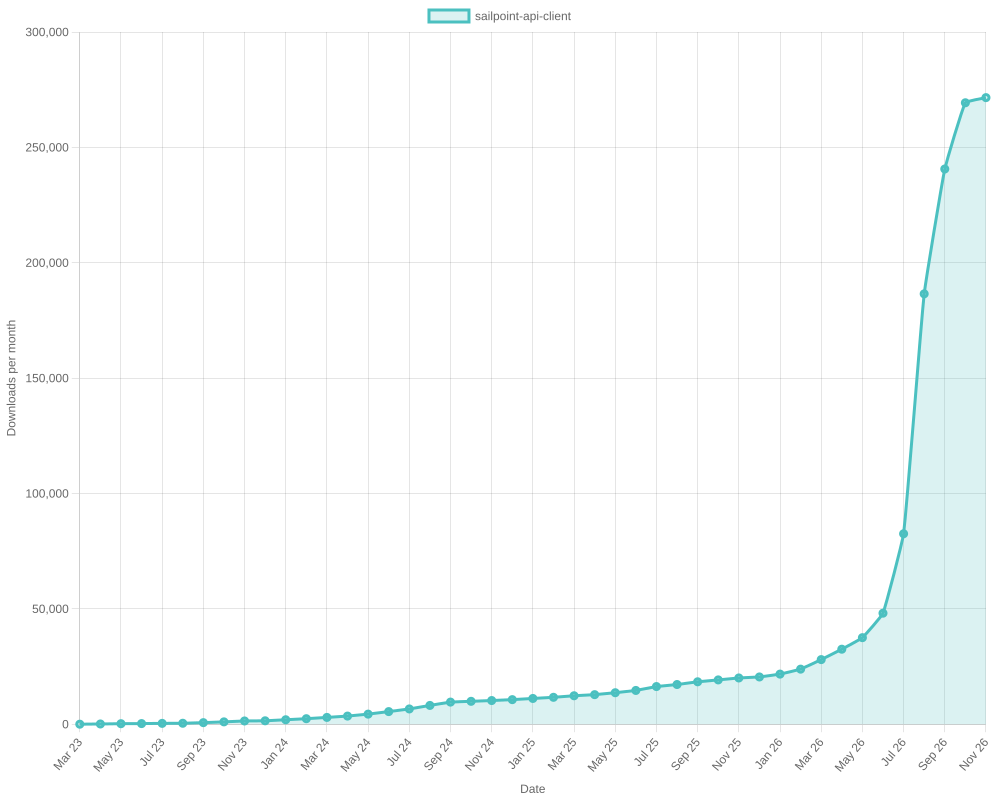

### GitHub: 

| Repository | Stars | Forks | Watchers | Open Issues | Closed Issues | Total Issues | Release Downloads | Releases | Latest Release | Language |
| --- | --- | --- | --- | --- | --- | --- | --- | --- | --- | --- |
| sailpoint-oss/sailpoint-cli | 50 | 38 | 8 | 13 | 36 | 49 | 23,478 | 39 | 2.7.0 | Go |
| sailpoint-oss/api-specs | 18 | 24 | 4 | 19 | 13 | 32 | 0 | 0 | N/A | JavaScript |
| **Total** | **68** | **62** | **12** | **32** | **49** | **81** | **23,478** | **39** | | |

#### Repository Details:

**sailpoint-oss/sailpoint-cli**:
- Last Activity: 4 days ago
- Repository Age: 1,564 days
- Release Count: 39
- Total Release Downloads: 23,478
- Latest Release: 2.7.0
- Latest Release Downloads: 2,215
- Views: 353
- Unique Visitors: 236
- Clones: 468
- Top Assets (by downloads):
  - sail_windows_amd64_msi: 5,635
  - sail_linux_amd64_deb: 3,818
  - sail_macos_arm64_tar.gz: 2,813
  - sail_windows_386_zip: 2,767
  - sail_windows_amd64_zip: 2,752
- OS Breakdown:
  - windows: 12,445
  - linux: 6,910
  - macos: 3,591
- Arch Breakdown:
  - amd64: 13,530
  - arm64: 4,643
  - 386: 3,384
  - armv6: 456
  - i386: 60
- Format Breakdown:
  - zip: 6,810
  - msi: 5,635
  - tar.gz: 5,018
  - deb: 4,493
  - rpm: 990

**sailpoint-oss/api-specs**:
- Last Activity: 0 days ago
- Repository Age: 1,522 days
- Release Count: 0
- Total Release Downloads: 0
- Latest Release: N/A
- Latest Release Downloads: 0
- Views: 253
- Unique Visitors: 72
- Clones: 7,007

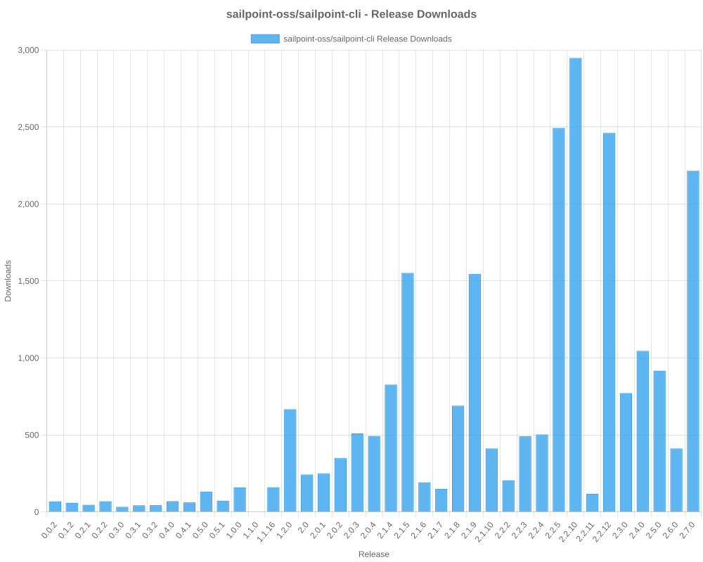
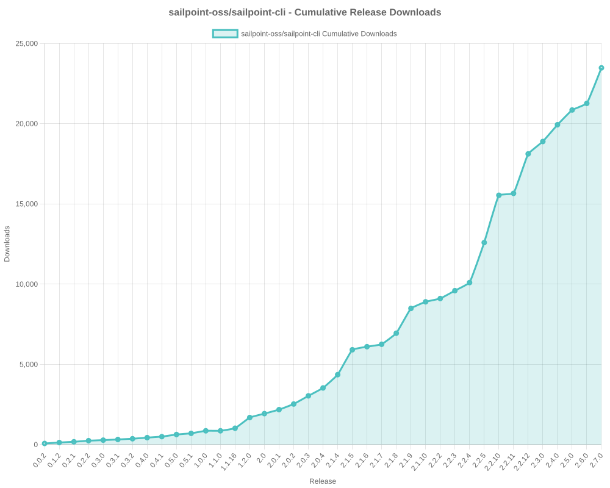
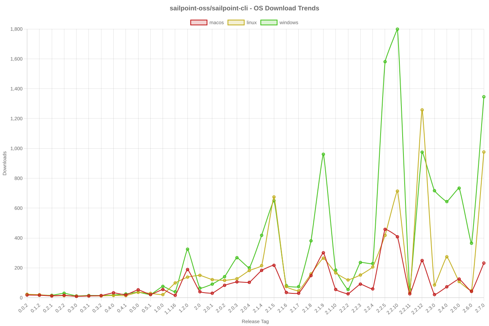
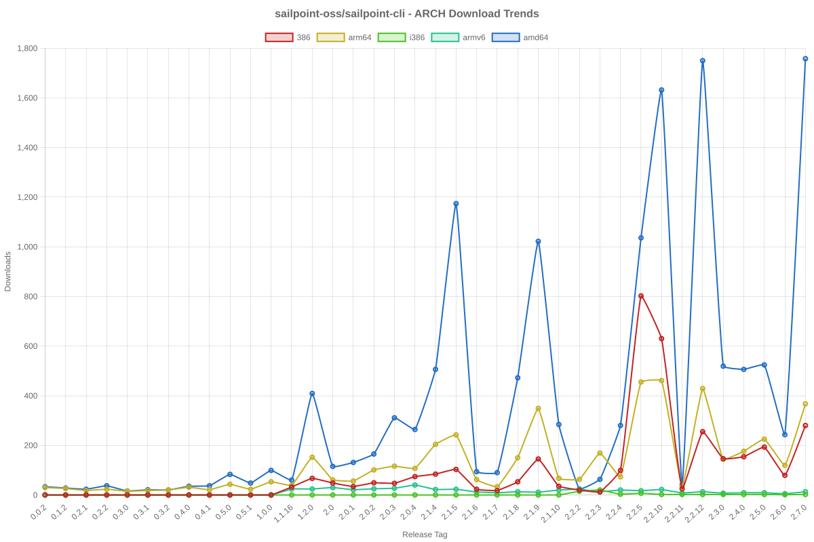
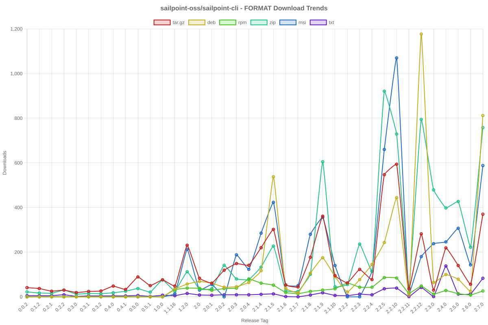

### PyPI (Python): 

| Package | Total Downloads | Monthly Downloads | Weekly Downloads | Daily Downloads | Version |
| --- | --- | --- | --- | --- | --- |
| sailpoint | 0 | 0 | 0 | 0 | N/A |
| **Total** | **0** | **0** | **0** | **0** | | |

#### Package Details:

**sailpoint**:
- Version: N/A
- Releases: 0

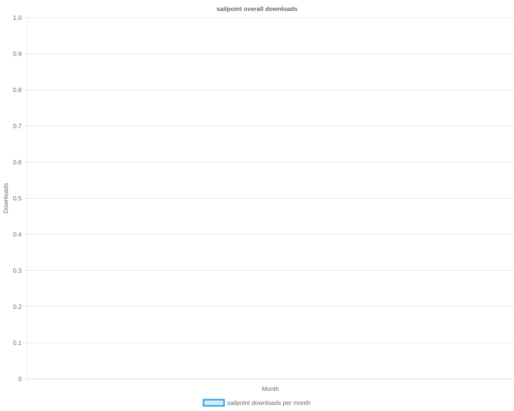
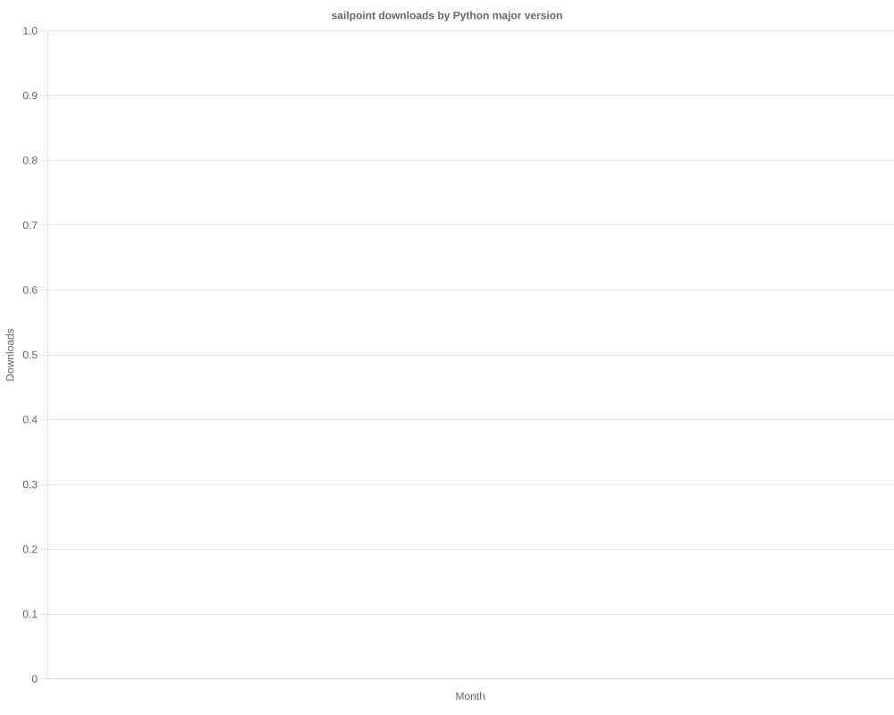

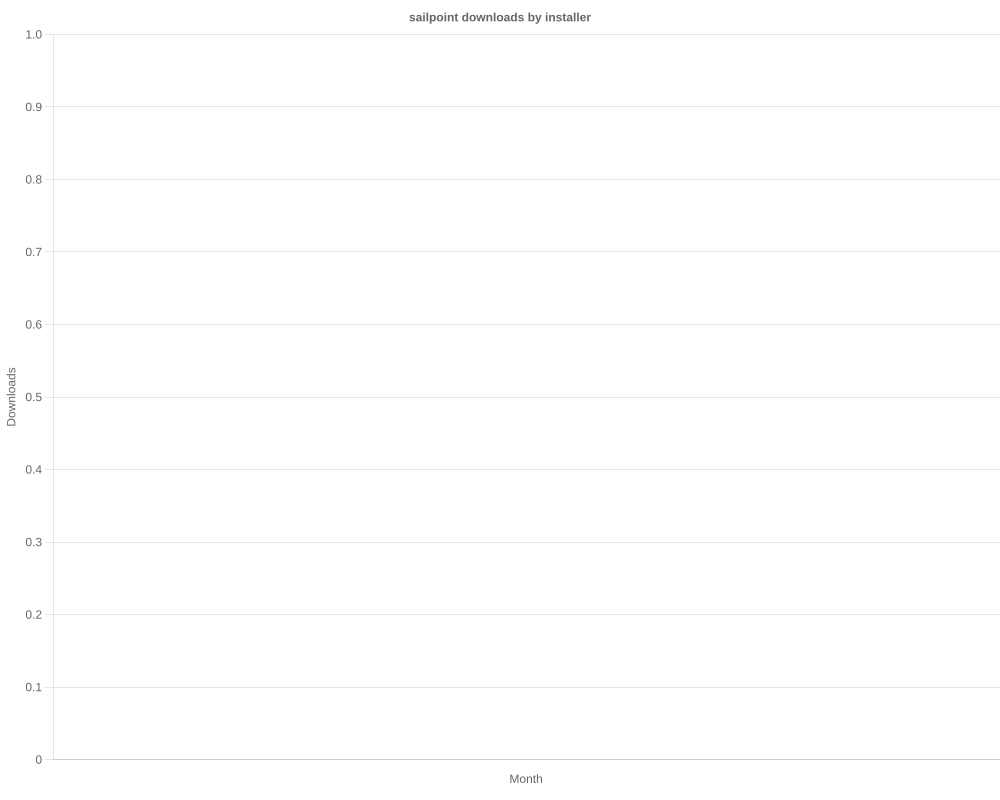

### PowerShell: 

| Module | Total Downloads | Latest Version | Version Downloads | Versions | Last Updated |
| --- | --- | --- | --- | --- | --- |
| PSSailPoint | 30,906 | N/A | 0 | 100 | 10/18/2026 |
| PSSailpoint.V3 | 18,461 | 1.7.22 | 912 | 39 | 11/1/2026 |
| PSSailpoint.Beta | 18,984 | 1.7.22 | 1,052 | 39 | 11/1/2026 |
| PSSailpoint.V2024 | 18,474 | 1.7.22 | 1,004 | 38 | 11/1/2026 |
| PSSailpoint.V2025 | 7,490 | 1.7.22 | 835 | 27 | 11/1/2026 |
| **Total** | **94,315** | | | **243** | |

#### PowerShell Module Details:

**PSSailPoint**:
- Total Downloads: 30,906
- Latest Version: N/A
- Latest Version Downloads: 0
- Version Count: 100
- Last Updated: 10/18/2026
- Package Size: 11792 KB

**PSSailpoint.V3**:
- Total Downloads: 18,461
- Latest Version: 1.7.22
- Latest Version Downloads: 912
- Version Count: 39
- Last Updated: 11/1/2026
- Package Size: 1016 KB

**PSSailpoint.Beta**:
- Total Downloads: 18,984
- Latest Version: 1.7.22
- Latest Version Downloads: 1,052
- Version Count: 39
- Last Updated: 11/1/2026
- Package Size: 1542 KB

**PSSailpoint.V2024**:
- Total Downloads: 18,474
- Latest Version: 1.7.22
- Latest Version Downloads: 1,004
- Version Count: 38
- Last Updated: 11/1/2026
- Package Size: 1903 KB

**PSSailpoint.V2025**:
- Total Downloads: 7,490
- Latest Version: 1.7.22
- Latest Version Downloads: 835
- Version Count: 27
- Last Updated: 11/1/2026
- Package Size: 2170 KB

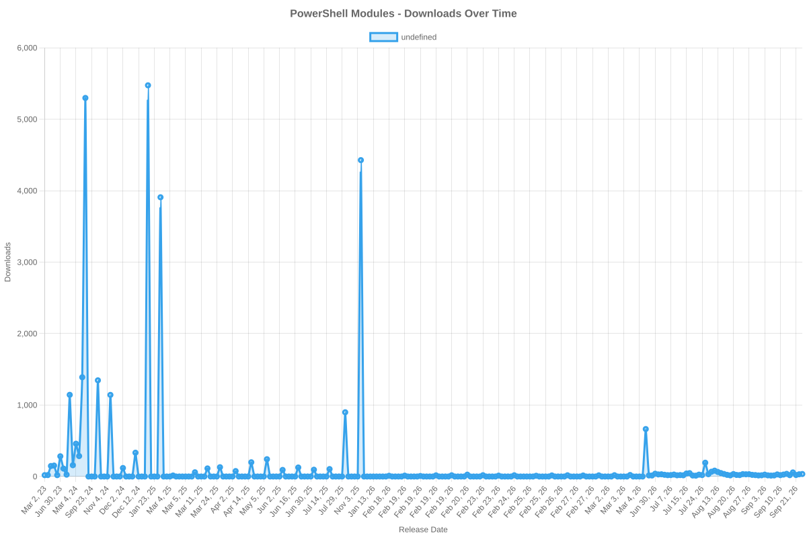
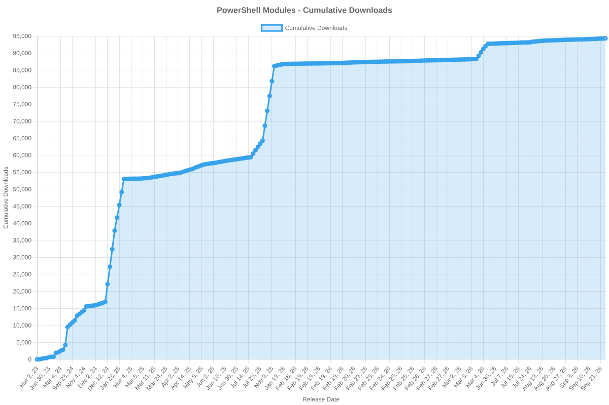

<!-- METRICS_END -->
