# SailPoint SDK Usage Statistics

<!-- METRICS_START -->
# Usage Statistics
    
Last updated: 10/5/2026, 12:06:16 AM

Below are stats from artifacts tracked across NPM, GitHub, PyPI and PowerShell.
    
### NPM (JavaScript/TypeScript): 

| Package | Downloads | Monthly Downloads | Weekly Downloads | Daily Downloads |
| --- | --- | --- | --- | --- |
| sailpoint-api-client | 236,286 | 45,255 | 3,572 | 2,169 |
| **Total** | **236,286** | **45,255** | **3,572** | **2,169** | | | | |

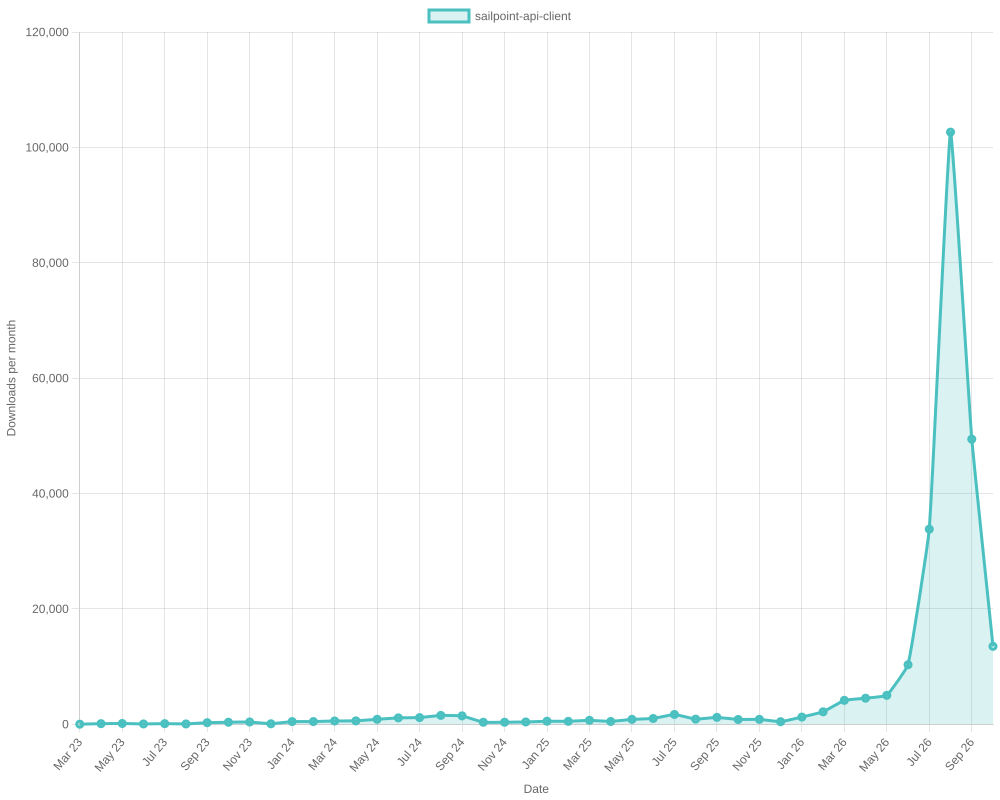
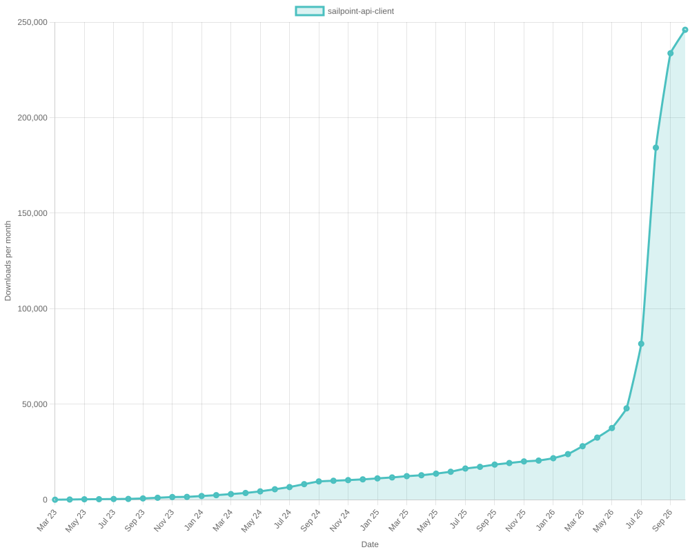

### GitHub: 

| Repository | Stars | Forks | Watchers | Open Issues | Closed Issues | Total Issues | Release Downloads | Releases | Latest Release | Language |
| --- | --- | --- | --- | --- | --- | --- | --- | --- | --- | --- |
| sailpoint-oss/sailpoint-cli | 48 | 34 | 8 | 11 | 36 | 47 | 20,342 | 39 | 2.7.0 | Go |
| sailpoint-oss/api-specs | 18 | 24 | 4 | 19 | 13 | 32 | 0 | 0 | N/A | JavaScript |
| **Total** | **66** | **58** | **12** | **30** | **49** | **79** | **20,342** | **39** | | |

#### Repository Details:

**sailpoint-oss/sailpoint-cli**:
- Last Activity: 3 days ago
- Repository Age: 1,536 days
- Release Count: 39
- Total Release Downloads: 20,342
- Latest Release: 2.7.0
- Latest Release Downloads: 225
- Views: 467
- Unique Visitors: 215
- Clones: 528
- Top Assets (by downloads):
  - sail_windows_amd64_msi: 5,036
  - sail_linux_amd64_deb: 3,061
  - sail_macos_arm64_tar.gz: 2,638
  - sail_windows_386_zip: 2,395
  - sail_windows_amd64_zip: 2,232
- OS Breakdown:
  - windows: 10,701
  - linux: 5,844
  - macos: 3,400
- Arch Breakdown:
  - amd64: 11,597
  - arm64: 4,167
  - 386: 2,984
  - armv6: 432
  - i386: 56
- Format Breakdown:
  - zip: 5,665
  - msi: 5,036
  - tar.gz: 4,603
  - deb: 3,699
  - rpm: 942

**sailpoint-oss/api-specs**:
- Last Activity: 0 days ago
- Repository Age: 1,494 days
- Release Count: 0
- Total Release Downloads: 0
- Latest Release: N/A
- Latest Release Downloads: 0
- Views: 329
- Unique Visitors: 88
- Clones: 666

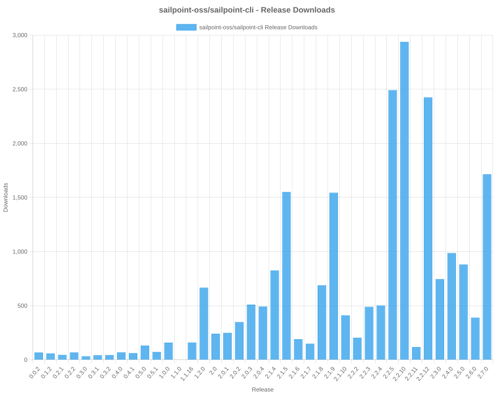
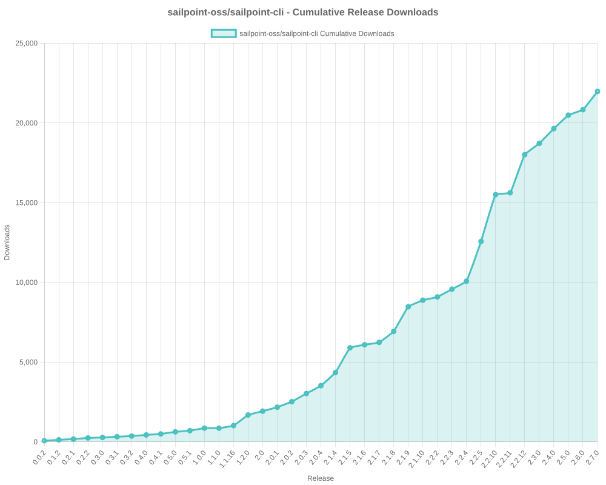
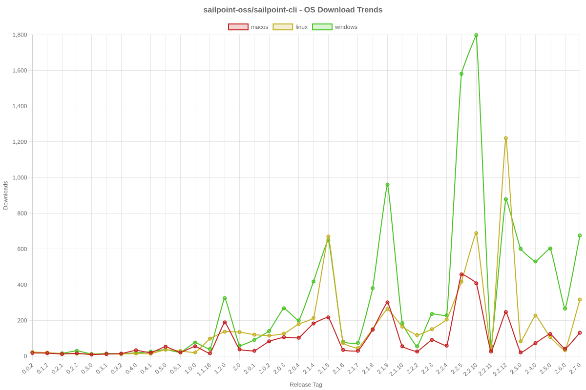
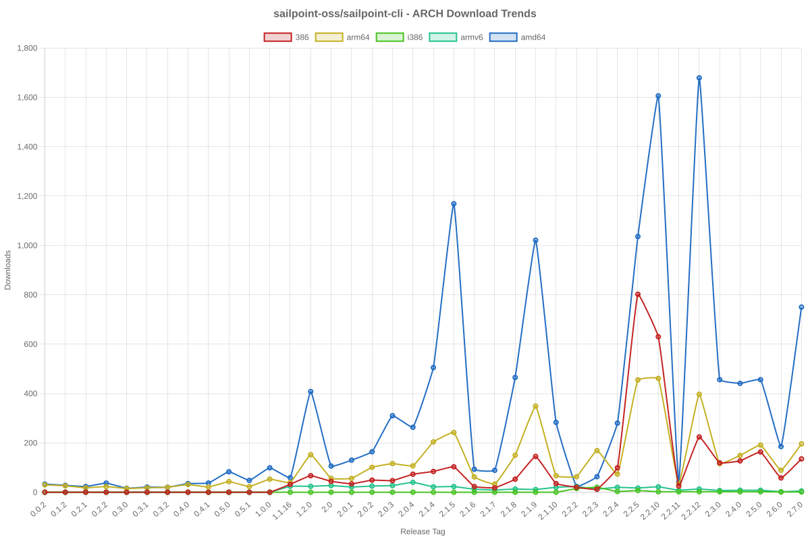
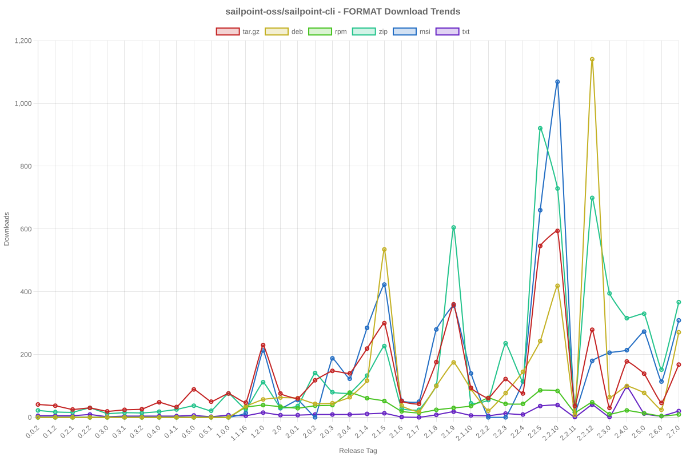

### PyPI (Python): 

| Package | Total Downloads | Monthly Downloads | Weekly Downloads | Daily Downloads | Version |
| --- | --- | --- | --- | --- | --- |
| sailpoint | 0 | 0 | 0 | 0 | N/A |
| **Total** | **0** | **0** | **0** | **0** | | |

#### Package Details:

**sailpoint**:
- Version: N/A
- Releases: 0

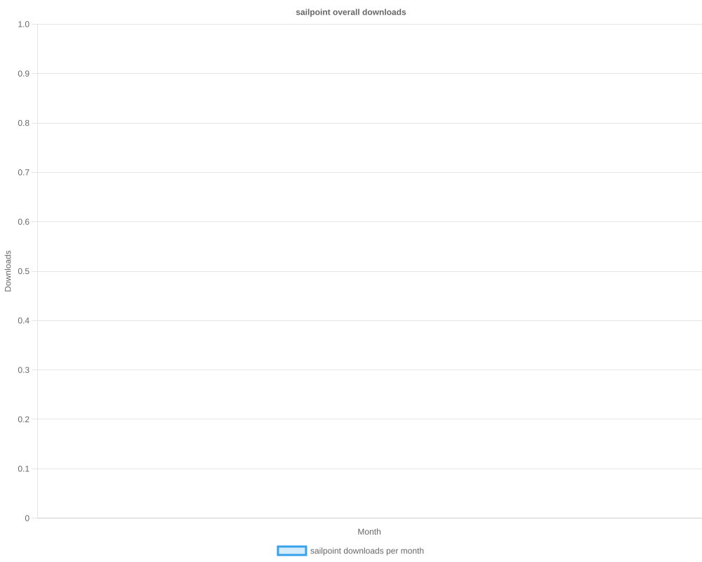
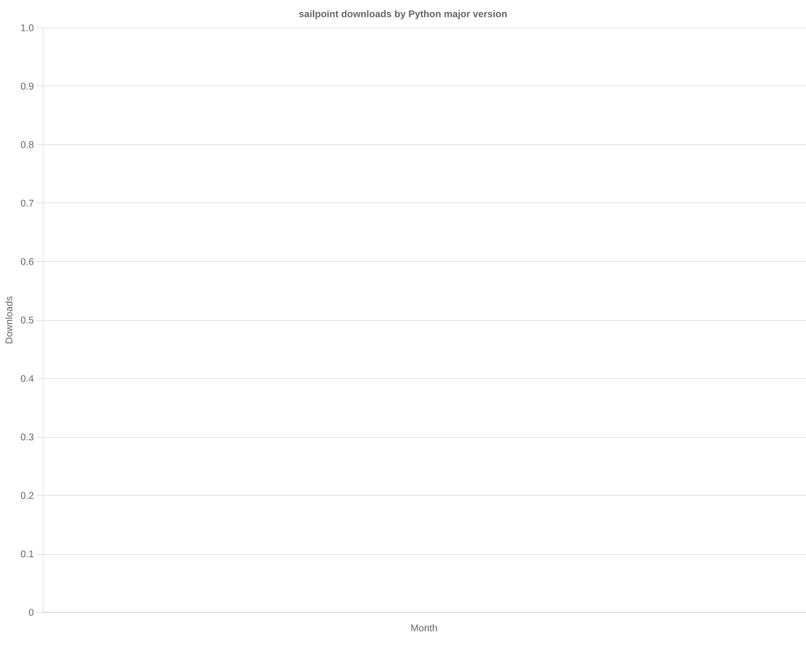

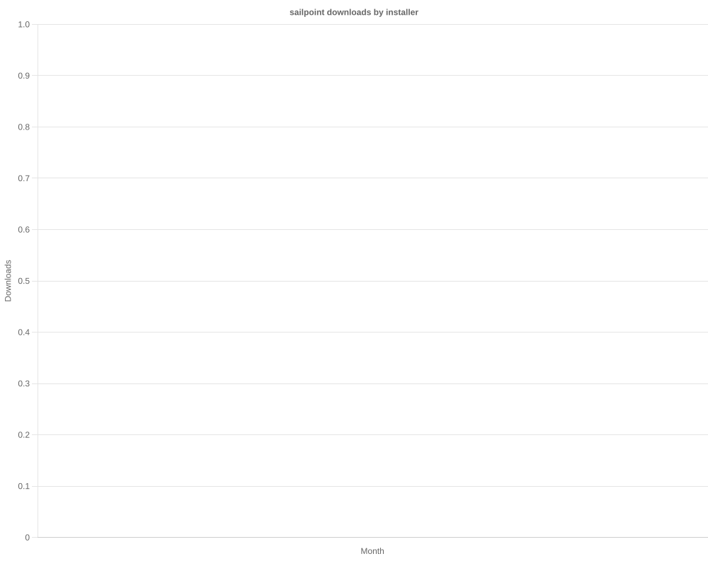

### PowerShell: 

| Module | Total Downloads | Latest Version | Version Downloads | Versions | Last Updated |
| --- | --- | --- | --- | --- | --- |
| PSSailPoint | 30,625 | N/A | 0 | 100 | 9/29/2026 |
| PSSailpoint.V3 | 18,403 | 1.7.22 | 872 | 39 | 10/4/2026 |
| PSSailpoint.Beta | 18,827 | 1.7.22 | 911 | 39 | 10/4/2026 |
| PSSailpoint.V2024 | 18,304 | 1.7.22 | 856 | 38 | 10/4/2026 |
| PSSailpoint.V2025 | 7,432 | 1.7.22 | 796 | 27 | 10/4/2026 |
| **Total** | **93,591** | | | **243** | |

#### PowerShell Module Details:

**PSSailPoint**:
- Total Downloads: 30,625
- Latest Version: N/A
- Latest Version Downloads: 0
- Version Count: 100
- Last Updated: 9/29/2026
- Package Size: 11792 KB

**PSSailpoint.V3**:
- Total Downloads: 18,403
- Latest Version: 1.7.22
- Latest Version Downloads: 872
- Version Count: 39
- Last Updated: 10/4/2026
- Package Size: 1016 KB

**PSSailpoint.Beta**:
- Total Downloads: 18,827
- Latest Version: 1.7.22
- Latest Version Downloads: 911
- Version Count: 39
- Last Updated: 10/4/2026
- Package Size: 1542 KB

**PSSailpoint.V2024**:
- Total Downloads: 18,304
- Latest Version: 1.7.22
- Latest Version Downloads: 856
- Version Count: 38
- Last Updated: 10/4/2026
- Package Size: 1903 KB

**PSSailpoint.V2025**:
- Total Downloads: 7,432
- Latest Version: 1.7.22
- Latest Version Downloads: 796
- Version Count: 27
- Last Updated: 10/4/2026
- Package Size: 2170 KB

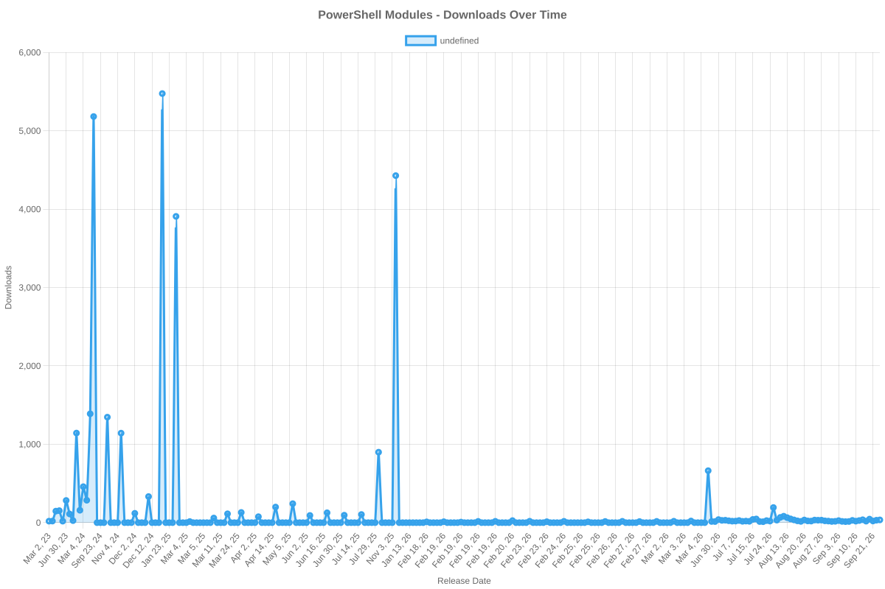
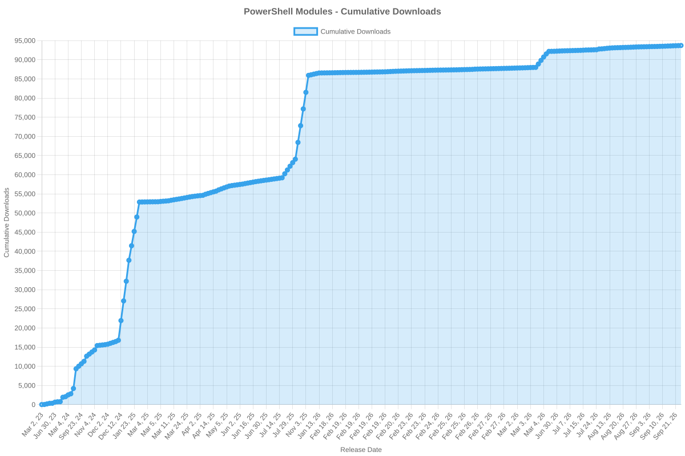

<!-- METRICS_END -->
